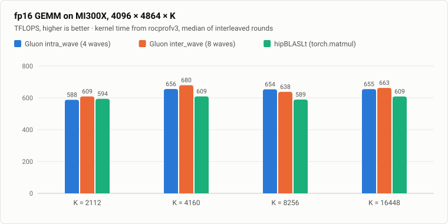
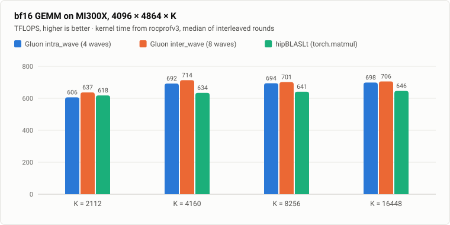

# gfx942 (MI300X) — a CDNA3 port of the a16w16 GEMM kernels

Two BF16/FP16 Gluon GEMM kernels for **gfx942 / MI300X (CDNA3)**, ported from
this repository's gfx950 kernels:

| | kernel | ported from |
|---|---|---|
| [`intra_wave/`](intra_wave/) | 4 warps/CTA, 1 wave/SIMD, compiler-interleaved | [`../intra_wave/a16w16/v9_beyond_hotloop`](../intra_wave/a16w16/v9_beyond_hotloop/) |
| [`inter_wave/`](inter_wave/) | 8 warps/CTA, 2 waves/SIMD, `warp_pipeline_stage` | [`../inter_wave/a16w16`](../inter_wave/a16w16/) |

> [!NOTE]
> These target **gfx942 (CDNA3)**, not the gfx950 (CDNA4) part the rest of the
> repository is written for. They are a separate port, not another version in
> the `v0 -> v9` arc: CDNA3's direct global-to-LDS load moves only 4 bytes per lane,
> so the kernels stage through registers instead, and CDNA3 has half the LDS. §4
> below is about what those two facts change.

Both keep the tutorial's core design — the 256×256 output tile sliced into a 2×2
grid of 128×128 quadrants and the XCD-aware PID remap with `GROUP_SIZE_M`
swizzling — and change only what CDNA3 forces them to change.

## How to read this

**Start here, then pick a kernel.** This file is the shared material: how to
build and run, every performance number for both kernels, and the CDNA3
constraints that both of them are shaped by. Neither kernel's design makes much
sense before §4.

| | |
|---|---|
| §1–2 | setup and how to run |
| **§3** | **all results** — both kernels, both dtypes, all shapes, one methodology |
| **§4** | **what CDNA3 forces to change** — the constraints common to both kernels |
| §5 | the MFMA scheduler on gfx942 |

Then read the kernel you care about. Each of those files assumes §4 and covers
only its own design:

* [**`intra_wave/README.md`**](intra_wave/README.md) — 4 waves, 1 per SIMD. The
  simpler shape: one wave per SIMD, so the compiler has to interleave memory with
  MFMA *within* a single instruction stream. Read this one first; it is where the
  CDNA3 problems are easiest to see.
* [**`inter_wave/README.md`**](inter_wave/README.md) — 8 waves, 2 per SIMD. The
  answer to those problems: two wave groups ping-pong so one is on the matrix
  unit while the other is in memory, which hides the very costs
  [`intra_wave`](intra_wave/) has to pay in-line.

## 1. Setup

```bash
git clone https://github.com/triton-lang/triton -b gfx950-tutorial-v3.1 /path/to/triton
pip uninstall -y triton
cd /path/to/triton && pip install -e .
```

[`gfx950-tutorial-v3.1`](https://github.com/triton-lang/triton/releases/tag/gfx950-tutorial-v3.1)
is the upstream Triton commit the MI300 kernels are expected to be used with.

## 2. Running

```bash
cd kernels/gemm/gfx942
python bench.py                                   # both kernels, fp16+bf16, vs torch
python bench.py -k inter_wave --K 4160 --dtype fp16 --show-clock
python bench.py --sweep-gm --K 4160               # GROUP_SIZE_M sweep
```

`bench.py` checks against an **fp32** reference (the kernels accumulate in fp32
and round once, so they are strictly more accurate than a half-precision
reference) and requires the error to be within 4 ulps of the peak output
magnitude. `--rocprof` switches to the tutorial's rotating-buffer mode for
external `rocprofv3 --kernel-trace` timing.

## 3. Results

MI300X (gfx942), 304 CUs, ROCm 7.2, Triton `gfx950-tutorial-v3.1`. M=4096, N=4864
with K swept (§3.1 discusses how the shape matters). TFLOPS come from the
repository's plain timing path, as for the gfx950 tables: `bench.py --rocprof` runs
1000 dispatches over 512 MB of rotating buffers under `rocprofv3 --kernel-trace`
with `AMD_SERIALIZE_KERNEL=3`, and
[`scripts/calc_kernel_time.py`](../../../scripts/calc_kernel_time.py) averages the
kernel duration over every dispatch:

```bash
AMD_SERIALIZE_KERNEL=3 rocprofv3 --kernel-trace --output-format csv -d trace \
    -- python bench.py --rocprof -k inter_wave --K 8256 --dtype fp16
python ../../../scripts/calc_kernel_time.py trace/*/*_kernel_trace.csv a16w16_inter_wave_gfx942
```

hipBLASLt is timed the same way through `torch.matmul` on the same operands
(`-k torch`; its kernel names start with `Cijk`). Each bar is the median of 3
rounds (5 at K=8256), a round running every configuration back to back.





**inter_wave wins 7 of 8 points** and beats hipBLASLt on all 8, by 2.1% to 12.4%;
it loses fp16 K=8256 (637.8 vs 653.7), the noisiest shape, where rounds spread by up
to 5.7%. intra_wave beats hipBLASLt on 6 of 8, by up to 10.8%, and loses at K=2112
(by 1.4% in fp16 and 2.4% in bf16).

In-loop **per-SIMD** MFMA efficiency (ATT, §3.3) moves with neither dtype nor K:
**90.8–90.9%** for intra_wave and **99.6–99.8%** for inter_wave (98.1–98.6% at
K=8256). The matrix unit is a per-SIMD resource, so the 8-wave kernel's per-wave
fraction doubles for its two co-resident waves. At ~99.7% the 8-wave loop is
essentially at the matrix-unit ceiling; [`intra_wave/README.md`](intra_wave/README.md)
shows via ablation that most of the 4-wave kernel's gap is `ds_write` the MFMA
stream cannot hide.

### 3.1 How the shape affects performance

This tutorial is about the inner loop: how close each kernel's main loop gets to the
matrix unit's peak, the efficiency figures above. Whole-kernel TFLOPS also depend on
the problem shape, through effects that live outside that loop. Same timing path,
fp16, median of 3 interleaved rounds:

| M×N×K | intra_wave TF | inter_wave TF | hipBLASLt TF |
|---|---|---|---|
| 4096×4096×4096 | 598.8 | 573.5 | 513.4 |
| 4096×4864×4096 | 650.9 | 643.1 | 586.6 |
| 4096×4864×4160 | 657.8 | 678.5 | 607.6 |
| 4096×4096×8192 | 614.2 | 592.3 | 543.7 |
| 4096×4864×8192 | 655.1 | 640.8 | 449.8 |
| 4096×4864×8256 | 628.9 | 634.9 | 592.6 |

**M and N: tile quantization.** With a 256x256 tile and one workgroup per CU (LDS is
full at 64 KB), 4096x4864 is a 16 x 19 = **304-workgroup** grid, exactly the MI300X CU
count, while 4096x4096 gives 256 workgroups and leaves 48 CUs idle for the whole
kernel. The full grid is worth +8.7% / +6.7% to intra_wave and +12.1% / +8.2% to
inter_wave (K = 4096 / 8192), less than its 19% more work, because the idle CUs leave
power under the 750 W cap and the busy ones clock higher (inter_wave runs at 1.48
GHz at 4096×4096×8192 and 1.34 GHz at 4096×4864×8192). This is a property of the grid,
not of the loop, and other algorithms address it: Stream-K, for example, splits the
K loop of the leftover tiles across CUs so a grid that does not divide the machine
still keeps every CU busy.

**K.** K sets how many loop iterations amortize the prologue and epilogue, which is
why K=2112 reads lowest in §3, and a power-of-two K makes A's row stride a power of
two (K=4096 -> 8192 B), so the rows of a tile map to the same cache sets. Here
`4160 = 65 x 64` and `8256 = 129 x 64` keep K a multiple of `BLOCK_K` but make the
stride an odd multiple of the 128 B line. For these kernels the stride effect is
small, +1.1% for intra_wave and +5.5% for inter_wave from K = 4096 to 4160, and does not
show at K ≈ 8192; hipBLASLt is far more sensitive (449.8 TFLOPS at K = 8192 against
592.6 at K = 8256). Both K effects are outside the loop too, and are handled the same
way, by the work decomposition (Stream-K, split-K) and by the data layout, rather
than by the loop's schedule. The benchmark shapes are chosen so that neither effect
clouds the comparison of the loops.

### 3.2 GROUP_SIZE_M

At this grid each XCD gets 304/8 = 38 workgroups, so the tutorial's model
(minimise `GM + ceil(38/GM)`) predicts GM = 5, 6 or 8 at f = 13, with GM = 4 just
behind at 14 and GM = 1/2/16 far worse at 39/21/19. Measured with
`bench.py --sweep-gm`, median of 4 runs at 4096x4864x4160 fp16:

| GM | f(GM) | intra_wave | inter_wave |
|---|---|---|---|
| 1 | 39 | 648.6 | 671.8 |
| 2 | 21 | 648.8 | 672.7 |
| 4 | 14 | 657.7 | 681.6 |
| 5 | 13 | 655.5 | 678.2 |
| 6 | 13 | 657.5 | 683.3 |
| 8 | 13 | 656.5 | 681.6 |
| 16 | 19 | 650.1 | 673.7 |

The model separates the bad choices correctly — GM = 1, 2 and 16 cost 1.2-1.7% —
but GM = 4 through 8 are within 0.8% of each other. **`GROUP_SIZE_M = 4` is
kept**; anything in 4-8 is equivalent here. (These are `do_bench` numbers.)

### 3.3 ATT traces

The repository's shared [`scripts/run_att.py`](../../../scripts/run_att.py) traces a
command with `rocprofv3 --att` and decodes it with
[`scripts/process_json.py`](../../../scripts/process_json.py), reading its configuration
from an `att_matmul.json` in the working directory (this one matches either kernel):

```bash
bash ../../../scripts/install_att_decoder.sh       # once
cat > att_matmul.json <<'EOF'
{"jobs": [{"kernel_include_regex": "a16w16_.*_gfx942", "kernel_exclude_regex": "",
           "kernel_iteration_range": "[15]", "advanced_thread_trace": true,
           "att_target_cu": 0, "att_shader_engine_mask": "0xF", "att_simd_select": "0xF",
           "att_buffer_size": "0x60000000"}]}
EOF
python ../../../scripts/run_att.py --att-output att_inter \
    python bench.py -k inter_wave --K 8256 --dtype fp16 --no-torch
```

`process_json.py` reports the efficiency per wave; the 8-wave kernel's per-SIMD figure
is twice that. The efficiencies above are the median of 3 traces (7 at K=8256).

## 4. What CDNA3 forces to change

Everything in this section applies to **both** kernels — it is the platform, not
the schedule. What each kernel then does about it is in its own README.

### 4.1 The register round trip

gfx950 streams HBM → LDS with `gl.amd.cdna4.async_copy.buffer_load_to_shared`, a
direct-to-LDS load of 16 bytes per lane (`buffer_load_dwordx4 ... lds`). CDNA3 loads
directly into LDS too, but only 4 bytes per lane (`buffer_load_dword ... lds`,
`global_load_lds_dword`; the 12- and 16-byte forms are new in CDNA4), so filling a
tile that way takes four times the load instructions of a `buffer_load_dwordx4`
into registers. On MI300 the round trip through registers is the faster path, and
both kernels take it:

```
buffer_load  (HBM -> VGPR)  ->  local_store (VGPR -> LDS)  ->  local_load (LDS -> VGPR)  ->  mfma
```

Two consequences, and they drive both kernels:

1. **32–64 VGPRs of staging** that gfx950 does not pay, which is what makes the
   register budget tight enough to shape the schedule.
2. **The LDS producer/consumer hazard is closed by real `s_barrier`s** inserted by
   Triton's membar pass, rather than by an async counter. `wait_group(n)` is a
   per-wave ordered wait and does not serialise anything; `s_barrier` stops every
   wave in the CTA. This is the single largest cost CDNA3 adds, and the two
   kernels differ mainly in how they hide it.

### 4.2 Half the LDS — 64 KB is exactly one stage

gfx950 has 160 KB of LDS per CU and double-buffers a 256×256×64 stage (2 × 64 KB).
gfx942 has **64 KB**, i.e. exactly one stage. Double buffering at this tile size
is impossible, so on gfx942 **LDS cannot be the pipeline buffer** — the registers
holding in-flight global loads are, and LDS is refilled in place. Each kernel
schedules that refill differently; see their READMEs.

**Why not `BLOCK_K=32` + double buffering?** It fits (8 × 8 KB = 64 KB) and it
does reduce the barrier count, which is what you would expect to want. It is
measurably worse — 400 TFLOPS vs 476 — and the reason is global coalescing, not
LDS. With `BLOCK_K=64` a row of the tile is 128 B, so eight lanes cover a whole
cache line and one `buffer_load_dwordx4` touches 8 back-to-back lines. At
`BLOCK_K=32` a row is 64 B, the same instruction touches 16 lines, and TCP
processing time per instruction roughly doubles. Ablating the `buffer_load`s out
of a `BLOCK_K=32` kernel moves it from 386 to 503 TFLOPS; ablating them out of the
`BLOCK_K=64` kernel changes nothing. Deepening the global staging to two K-steps
did not help either (v4, 400 TFLOPS) — it is the cache-line count, not the
latency. **Both kernels therefore keep `BLOCK_K=64` and slice only on the LDS-read
side.**

### 4.3 MFMA shape

CDNA3's widest 16×16 f16/bf16 intrinsic is `v_mfma_f32_16x16x16_f16`
(`AMDMFMALayout(version=3, instr_shape=[16,16,16])`), **16 cycles**, versus CDNA4's
`..._16x16x32_f16` at 32. `k_width=8` still yields `ds_read_b128`: the dot-operand
K tile is `8 × (64/16) = 32`, which Triton lowers to two K=16 MFMAs.

Same total matrix work, twice the instructions — which matters less than it
sounds. A K-step is ~2048 cycles of MFMA per wave either way, so the *rate* at
which a schedule must feed the matrix unit is unchanged; only the instruction
count inside each region doubles.

CDNA3's LDS is also **128 B/clk against CDNA4's 256**, so every `ds_read_b128` /
`ds_write_b128` occupies the port twice as long relative to the same MFMA work.

### 4.4 LDS layout — `SwizzledSharedLayout(8, 1, 8)`

Both kernels use the same shared layout, and both had to co-design it with the
global-load layout. gfx950's `PaddedSharedLayout([[512, 16]])` spends LDS to
sidestep bank conflicts; with LDS full to the byte that option is gone, so the
swizzle has to be exactly right.

The parameters place element `(r, c)` at column
`((c / vec) ^ phase) * vec + (c % vec)`, with `phase = (r / per_phase) % max_phase`:

* `vec = 8` — swizzle granularity; 8 fp16 = 16 B, which keeps `ds_read_b128` /
  `ds_write_b128` legal.
* `per_phase = 1` — one row per phase.
* `max_phase = 8` — 8 distinct phases before the pattern repeats.

**`per_phase = 1`, not 2.** The global-load layout has consecutive lanes walking
consecutive rows, so lanes 0–15 of a `b128` access cover *two adjacent rows*. With
`per_phase = 2` those two rows share a phase, land on the same 32 banks, and every
access replays. Measured with three hardware counters, fp16 K=8256, per dispatch:

```bash
rocprofv3 --pmc SQ_LDS_BANK_CONFLICT SQ_LDS_IDX_ACTIVE SQ_INSTS_LDS --output-format csv -d lds \
    -- python bench.py --rocprof -k inter_wave --K 8256 --dtype fp16
```

conflict ratio = `SQ_LDS_BANK_CONFLICT / (SQ_LDS_IDX_ACTIVE - SQ_LDS_BANK_CONFLICT)`
(replay cycles per useful cycle) and cycles per LDS instruction =
`SQ_LDS_IDX_ACTIVE / SQ_INSTS_LDS`. Both kernels take the layout from
`GFX942_SWZ_VEC` / `GFX942_SWZ_PER_PHASE` / `GFX942_SWZ_MAX_PHASE`, so
`GFX942_SWZ_PER_PHASE=2` measures `(8, 2, 8)`; give each layout its own
`TRITON_CACHE_DIR`, because the swizzle is not part of Triton's cache key.

| | conflict ratio | cyc / LDS instr | intra_wave `IDX_ACTIVE` | inter_wave `IDX_ACTIVE` |
|---|---|---|---|---|
| `(8, 2, 8)` | 0.667 / 0.750 | 13.33 / 14.00 | 1.004e8 | 1.406e8 |
| **`(8, 1, 8)`** | **0.000** | **8.00** | **6.02e7** | **8.03e7** |

8.00 cyc/instr is the floor (1024 B at 128 B/clk). In loop cycles (ATT, fp16
K=4160) the fix is worth **−16.2%** on the 4-wave kernel (5375.3 → 4507.2) and
**−10.8%** on the 8-wave one (4603.6 → 4107.6). The 4-wave kernel is the more
sensitive because Triton's MFMA scheduler spaces its MFMAs for the conflict-free
LDS cost, so every replayed access lands on the critical path.

Getting the `local_store` side conflict-free also required **changing the
global-load layout** away from the tutorial's. The gfx950 layout has lanes 0–7
cover row `M0` and lanes 8–15 cover row `M0+16`; with a 128 B row stride those two
rows land on the same banks and *no swizzle can separate them*, because the
swizzle only permutes chunks within a row. Remapping so consecutive lanes walk
consecutive rows makes lanes 0–15 cover two adjacent 128 B rows = 256 B = all 64
banks exactly once, and improves the global side too (one instruction now reads
1024 contiguous bytes).

### 4.5 Where the two kernels diverge

Given §4.1–4.4, the remaining question is *who hides the barriers and the LDS
writes*, and that is the whole difference between the two kernels:

| | [`intra_wave`](intra_wave/) (4 waves, 1/SIMD) | [`inter_wave`](inter_wave/) (8 waves, 2/SIMD) |
|---|---|---|
| hides memory behind | MFMA in the **same** instruction stream | the **other wave group** |
| needs | Triton's MFMA scheduler to interleave (§5) | `warp_pipeline_stage` and a barrier per region |
| accumulators | AGPR — separate capacity at 1 wave/SIMD | VGPR — 2 waves split one 512-register file |
| LDS refill | per half-tile, one region after its last read | whole tensors, late in the body |
| ceiling | `ds_write` issue cost the MFMA stream cannot absorb | ~99.7% per-SIMD; barriers and write turnaround |

The 4-wave kernel is the more instructive read and the 8-wave one is the faster
kernel. Both READMEs assume this section.

## 5. The MFMA scheduler on gfx942

The 4-wave kernel's MFMA <-> memory interleave comes from Triton's MFMA scheduler,
an LLVM-IR pass in `third_party/amd/lib/Target/MFMASchedule/MFMASchedule.cpp` that a
kernel opts into per launch with `schedule_hint="mfma-schedule"`; `intra_wave`'s
`matmul()` passes it, and `bench.py --schedule-hint ""` turns it off. The pass is
introduced in [a16w16 v5](../intra_wave/a16w16/v5_local_prefetch/README.md#5-introduction-to-the-mfma-scheduler).
The 8-wave kernel does not use it: its schedule is written with `warp_pipeline_stage`.

**What MI300 adds to the model: the LDS bandwidth.** The pass spaces MFMAs around
each memory op by the cycles that op occupies its issue port. CDNA3's LDS serves
128 B/clk against CDNA4's 256, so with all four SIMDs issuing it a `ds_read_b128` or
`ds_write_b128` needs 32 cycles of MFMA cover instead of 16, and the pass places two
16-cycle MFMAs per 128-bit LDS access instead of one. That is the only per-target
constant; priced at CDNA4's rate, the same pass leaves the 4-wave loop at 79.4%.

**Everything else carries over unchanged**, which is a fair test of the pass's
robustness: the MFMA cycle table already covers CDNA3's `16x16x16` shapes; the gfx942
kernels fill LDS with `ds_write` (an LDS-write anchor) where the gfx950 ones use
`buffer_load ... lds` (a global-load anchor); and the `cd_regclass="a"` accumulator
pins travel with their MFMAs on both. On the 4-wave kernel (bf16; ATT cycles per
K-iteration / per-SIMD in-loop MFMA efficiency):

| | K=2112 | K=4160 | K=8256 | K=16448 |
|---|---|---|---|---|
| scheduler off (`--schedule-hint ""`) | 5867.2 / 69.8% | 5870.9 / 69.8% | 5872.6 / 69.7% | 5873.2 / 69.7% |
| **scheduler on** | **4506.4 / 90.9%** | **4507.3 / 90.9%** | **4507.6 / 90.9%** | **4507.8 / 90.9%** |

That is +11.1% to +12.2% TFLOPS in fp16 and +12.8% to +14.1% in bf16, paired within
each round of §3. In the other direction, adding the gfx942 model left every gfx950
kernel that uses the pass byte-identical.
