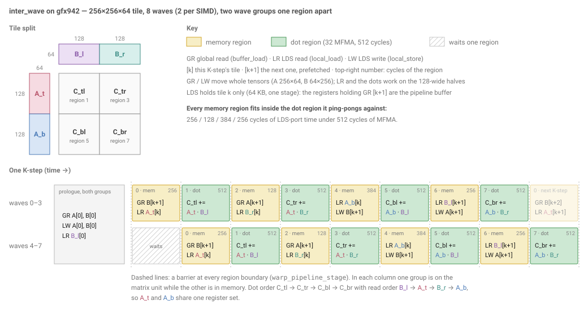

# inter_wave — 8-wave a16w16 GEMM for gfx942 / MI300X

The gfx950 tutorial's [`inter_wave/a16w16`](../../inter_wave/a16w16) kernel moved to
MI300X: 8 warps/CTA = **2 waves/SIMD**, `warps_per_cta = [2, 4]`, the same 256×256×64
tile split into a 2×2 grid of 128×128 quadrants, and XCD-aware PID remapping with
`GROUP_SIZE_M=4`. Two wave groups ping-pong through `warp_pipeline_stage`: while one
is on the matrix unit, the other is in memory. The design is gfx950's; what changes is
where the next tile waits and, because of that, the order of the dots (§2). The
`ds_write`s that hold [`../intra_wave`](../intra_wave/) to ~91% land here in the memory
regions, behind the other group's MFMAs, and the loop reaches ~99.7% (§3).

> **Read [`../README.md`](../README.md) first.** It has the performance numbers (§3) and the
> CDNA3 constraints (§4) this file assumes. [`../intra_wave/README.md`](../intra_wave/README.md)
> walks through the same migration at 1 wave/SIMD.

```bash
cd ..                                              # kernels/gemm/gfx942
python bench.py -k inter_wave                      # correctness + TFLOPS (do_bench)
AMD_SERIALIZE_KERNEL=3 rocprofv3 --kernel-trace --output-format csv -d trace \
    -- python bench.py --rocprof -k inter_wave --K 8256 --dtype fp16       # timing, ../README.md §3
python ../../../scripts/run_att.py --att-output att \
    python bench.py -k inter_wave --K 8256 --dtype fp16 --no-torch         # ATT, ../README.md §3.3
```

## 1. Design



**Tile split** (top left). A is split along M into `A_t` / `A_b` and B along N into
`B_l` / `B_r`; each pair produces one 128×128 quadrant of C, and each dot region
computes one quadrant.

**One K-step** (bottom). Eight regions, memory and dot strictly alternating, with a
barrier at every boundary. The two wave groups (waves 0–3 and 4–7) run one region
apart, which is what `warp_pipeline_stage` sets up, so in every column one group is
on the matrix unit while the other is in memory. Region by region, tile *k* is
consumed while tile *k+1* is prefetched:

| region | kind | work | instructions | cycles |
|---|---|---|---|---|
| 0 | mem | `GR B[k+1]`, `LR A_t[k]` | 4 `buffer_load_dwordx4` + 8 `ds_read_b128` | 256 |
| 1 | dot | `C_tl += A_t × B_l` | 32 MFMA | 512 |
| 2 | mem | `GR A[k+1]`, `LR B_r[k]` | 4 `buffer_load_dwordx4` + 4 `ds_read_b128` | 128 |
| 3 | dot | `C_tr += A_t × B_r` | 32 MFMA | 512 |
| 4 | mem | `LR A_b[k]`, `LW B[k+1]` | 8 `ds_read_b128` + 4 `ds_write_b128` | 384 |
| 5 | dot | `C_bl += A_b × B_l` | 32 MFMA | 512 |
| 6 | mem | `LR B_l[k+1]`, `LW A[k+1]` | 4 `ds_read_b128` + 4 `ds_write_b128` | 256 |
| 7 | dot | `C_br += A_b × B_r` | 32 MFMA | 512 |

A memory region's cycles are its LDS-port time, with 4 of the 8 waves in memory at
128 B/clk.

**Whole tensors in, half-tiles out.** GR and LW move whole tensors (A is 256×64, B
64×256); LR and the dots work on 128-wide halves sliced out of the same LDS buffers.
The slice is along M or N, never along K, the swizzled dimension, so slicing leaves
the shared layout alone.

**One LDS buffer.** A and B take 32 KB each, exactly MI300X's 64 KB. LDS holds tile
*k*, and tile *k+1* waits in registers from its GR until the last read of tile *k*
from that tensor: B is written in region 4, after `B_r[k]` is read in region 2, and A
in region 6, after `A_b[k]` is read in region 4. B goes first because region 6 reads
`B_l[k+1]`. Each store sits four regions after its load, with two dot regions in
between to cover global latency, and every read/write hazard is closed by a region
boundary.

## 2. From gfx950 to gfx942

Side by side, the two kernels are the same design:

| | gfx950 [`inter_wave/a16w16`](../../inter_wave/a16w16) | gfx942, this kernel |
|---|---|---|
| waves | 8, two per SIMD, `warps_per_cta = [2, 4]` | same |
| tile and split | 256×256×64, A in halves along M × B in halves along N | same |
| ping-pong | `warp_pipeline_stage`, two wave groups one region apart | same |
| regions per K-step | 8: 4 dot + 4 memory, a barrier at each boundary | same |
| MFMA cycles per dot region | 512 | same |
| accumulators | VGPRs (`amdgpu-agpr-alloc=0,0`) | same |
| schedule | `warp_pipeline_stage` only, no MFMA scheduler | same |
| global load | per half-tile, straight into LDS (`buffer_load_to_shared`), 2 K-steps ahead | per whole tensor, into registers (`buffer_load`), 1 K-step ahead |
| LDS | 2 buffers × 4 half-tiles, padded: ~132 KB | 1 buffer × 2 whole tensors, swizzled: exactly 64 KB ([`../README.md`](../README.md) §4.4) |
| the next tile waits in | the second LDS buffer | 32 VGPRs of staging |
| `ds_write` in the loop | none: the async copy writes LDS | 8 `ds_write_b128` per K-step, in regions 4 and 6 |
| dot order | `C_tl → C_bl → C_tr → C_br` | `C_tl → C_tr → C_bl → C_br` |
| loop | 2× unrolled, alternating buffers | not unrolled |
| MFMAs per dot region | 16 (`16x16x32`) | 32 (`16x16x16`, [`../README.md`](../README.md) §4.3) |

Region by region, one K-step of each (gfx950 runs each dot before its memory region,
gfx942 after):

| | gfx950: dot | gfx950: memory | gfx942: memory | gfx942: dot |
|---|---|---|---|---|
| 1st | `C_tl` | `LR A_bot(k)`, copy `B_left(k+2)` | `GR B(k+1)`, `LR A_t(k)` | `C_tl` |
| 2nd | `C_bl` | `LR B_right(k)`, copy `A_top(k+2)` | `GR A(k+1)`, `LR B_r(k)` | `C_tr` |
| 3rd | `C_tr` | `LR B_left(k+1)`, copy `A_bot(k+2)` | `LR A_b(k)`, `LW B(k+1)` | `C_bl` |
| 4th | `C_br` | `LR A_top(k+1)`, copy `B_right(k+2)` | `LR B_l(k+1)`, `LW A(k+1)` | `C_br` |

The skeleton (eight regions, two wave groups, the same MFMA cadence) is unchanged.
What changes is the memory side, and the dot order follows from it.

**The second LDS buffer becomes registers.** As in
[`../intra_wave`](../intra_wave/README.md#2-from-gfx950-to-gfx942), MI300X's LDS holds
one stage ([`../README.md`](../README.md) §4.2) and the round trip through registers
is the faster path (§4.1), so tile *k+1* waits in 32 VGPRs of staging instead of a
second buffer. With one LDS slot per tensor, a tensor can be rewritten only after its
last read of tile *k*: GR moves to the first half of the K-step and LW to the second,
and the prefetch runs one K-step ahead instead of two.

**The `ds_write`s join the memory regions.** gfx950's async copy costs a memory region
only its address computation. Here the same traffic is 4 `ds_write_b128` per tensor,
sharing the LDS port with that region's reads, which is why regions 4 and 6 are the
heavy ones. §3 is why this costs almost nothing.

**The staging registers force a new dot order.** Two waves per SIMD split the unified
512-register file, so each wave has **256 registers, VGPR and AGPR together**, and
AGPRs add no capacity; both kernels keep the accumulators in VGPRs. Per lane (8 waves
× 64 lanes = 512 lanes per CTA; a register holds one f32 or two f16):

| holds | VGPRs | how |
|---|---|---|
| C accumulators, all four quadrants | 128 | 4 × 128×128 f32 ÷ 512 lanes |
| `A_t` / `A_b`, **one shared set** | 32 | a 64×64 f16 slice per wave ÷ 64 lanes |
| `B_l`, `B_r` | 16 each | a 64×32 f16 slice per wave ÷ 64 lanes |
| global staging, A and B in flight | 32 | 64 KB ÷ 512 lanes |
| addresses, offsets, loop state | the rest | 240 in all, 0 spills |

gfx950's order keeps all four half-tiles live at once: 96 operand VGPRs, 242 in all,
with no staging to pay for. With independent registers for all four half-tiles,
gfx942's 32 staging VGPRs bring the count to 256 before addressing, and the kernel
compiles to 256 VGPRs with 28 spill slots. gfx942 instead runs the two dots on `A_t`
back to back (regions 1 and 3), then the two on `A_b` (5 and 7), reading the operands
in the order `B_l → A_t → B_r → A_b`. `A_t` is then live only
across regions 1–3 and `A_b` only across 5–7, so the two share one register set, and
the operands cost 64 VGPRs instead of 96.

**No unroll.** gfx950 unrolls twice to alternate its two buffers; with one buffer
there is nothing to alternate.

**No padding.** The two tensors fill LDS to the byte, so gfx950's padded layout no
longer fits and the buffers are swizzled instead, with no bank conflicts. The
conflict-free swizzle cuts loop cycles by 10.8% against one that conflicts
(`(8, 2, 8)`, [`../README.md`](../README.md) §4.4).

**The same cadence.** gfx950's dot region is 16 MFMAs of 32 cycles, gfx942's 32 of
16 cycles: 512 cycles either way. The groups swap as often as on gfx950; only the
instruction count inside a dot region doubles.

## 3. Hiding the `ds_write`s

The loop holds **99.6–99.8%** in-loop MFMA efficiency per SIMD (98.1–98.6% at
K=8256; [`../README.md`](../README.md) §3), against intra_wave's 90.8–90.9%. The
`ds_write_b128`s are the same instructions that cost intra_wave 320 cycles per
K-step: each takes ~20 cycles to issue, against a 16-cycle MFMA.

The difference is which stream issues them. In intra_wave they sit between a wave's
own MFMAs, and an MFMA cannot cover one. Here they sit in a memory region, while the
*other* group's dot region holds the matrix unit, so a memory region only has to
finish inside 512 cycles. Every one does: 256 / 128 / 384 / 256 cycles of LDS-port
time, regions 4 and 6 with their writes included. This is the gfx942 counterpart of
gfx950's `buffer_load_to_shared`: the writes are not removed from the instruction
stream, but moved to a stream that is not on the matrix unit.

With the loop at the matrix-unit ceiling, the remaining gaps are outside it: the
grid against the CU count, the prologue and epilogue at small K, and the clock under
the 750 W cap ([`../README.md`](../README.md) §3.1).

---

That is the end of the reading path. To go further:
[`../README.md`](../README.md) §3 for the numbers,
[`../intra_wave/README.md`](../intra_wave/README.md) for the same migration at 1 wave/SIMD,
and the repository's [`scripts/`](../../../../scripts/README.md) for the measurement
harnesses.
