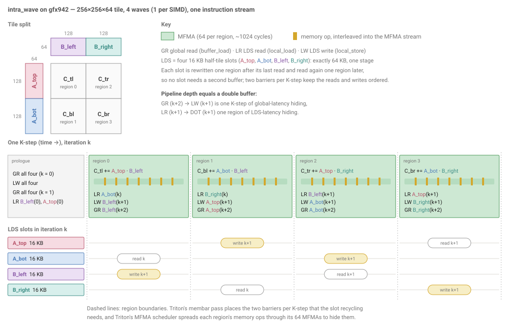

# intra_wave — 4-wave a16w16 GEMM for gfx942 / MI300X

The gfx950 tutorial's [`v9_beyond_hotloop`](../../intra_wave/a16w16/v9_beyond_hotloop) kernel
moved to MI300X: 4 warps/CTA = **1 wave/SIMD**, a 256×256×64 tile split into a 2×2 grid
of 128×128 quadrants, and XCD-aware PID remapping with `GROUP_SIZE_M=4`. The design is
v9's; what changes is where the next tile waits (§2). At 1 wave/SIMD there is nothing to
hide behind — the memory ops and the MFMAs share one instruction stream — so this is
also where the cost of MI300's LDS writes is easiest to see (§3).

> **Read [`../README.md`](../README.md) first.** It has the performance numbers (§3) and the
> CDNA3 constraints (§4) this file assumes.

```bash
cd ..                                              # kernels/gemm/gfx942
python bench.py -k intra_wave                      # correctness + TFLOPS (do_bench)
AMD_SERIALIZE_KERNEL=3 rocprofv3 --kernel-trace --output-format csv -d trace \
    -- python bench.py --rocprof -k intra_wave --K 8256 --dtype fp16       # timing, ../README.md §3
python ../../../scripts/run_att.py --att-output att \
    python bench.py -k intra_wave --K 8256 --dtype fp16 --no-torch         # ATT, ../README.md §3.3
```

## 1. Design



**Tile split** (top left). A is split along M into `A_top` / `A_bot` and B along N into
`B_left` / `B_right`; each pair produces one 128×128 quadrant of C.

**One K-step** (bottom). Four regions run in one instruction stream, one quadrant each,
in the order `C_tl → C_bl → C_tr → C_br`. Each region is 64 MFMAs (~1024 cycles), and
Triton's MFMA scheduler spreads three memory ops through them:

* **LR** reads from LDS the next operand the DOT sequence needs, at least one region
  before it is used;
* **LW** writes one half-tile of the *next* K-step into LDS;
* **GR** loads the same half-tile *two* K-steps ahead from global memory into
  registers.

**Half-tile LDS slots** (the lanes below). LDS holds four 16 KB slots, one per half-tile:
exactly 64 KB, a single stage. A whole region separates each slot's last read from
its rewrite, and the rewrite from its next read, so a slot is never read and written
in the same region and no slot needs a second copy. Triton's membar pass orders the reads and
writes with two barriers per K-step.

**Pipeline depth.** `GR (k+2) → LW (k+1)` is a full K-step (~4096 cycles) of
global-latency hiding, and `LR (k+1) → DOT (k+1)` one region (~1024 cycles) of
LDS-latency hiding — the same depth as gfx950's double buffer, which is the point of §2.

## 2. From gfx950 to gfx942

Side by side, the two kernels are the same design:

| | gfx950 [v9](../../intra_wave/a16w16/v9_beyond_hotloop) | gfx942, this kernel |
|---|---|---|
| waves | 4, one per SIMD | same |
| tile and split | 256×256×64, `A_top`/`A_bot` × `B_left`/`B_right` | same |
| regions per K-step | 4: `C_tl → C_bl → C_tr → C_br` | same |
| LDS read per region | the next region's operand | same |
| global load | straight into LDS (`buffer_load_to_shared`), 2 K-steps ahead | into registers (`buffer_load`), 2 K-steps ahead |
| LDS | 2 buffers × 4 half-tiles, padded: ~132 KB | 1 buffer × 4 half-tiles, swizzled: exactly 64 KB ([`../README.md`](../README.md) §4.4) |
| the next tile waits in | the second LDS buffer | registers |
| `ds_write` in the loop | none: the async copy writes LDS | 16 `ds_write_b128` per K-step, 4 per region |
| loop | 2× unrolled, alternating buffers | not unrolled |
| MFMAs per region | 32 (`16x16x32`) | 64 (`16x16x16`, [`../README.md`](../README.md) §4.3) |
| accumulators | AGPRs (`cd_regclass="a"`) | same |
| schedule | Triton's MFMA scheduler | same pass, with CDNA3's LDS bandwidth ([`../README.md`](../README.md) §5) |

Region by region, only the global load moves:

| region | DOT | LR | gfx950: async copy into LDS | gfx942: LW from registers, GR into registers |
|---|---|---|---|---|
| 0 | `C_tl` | `A_bot(k)` | `B_left(k+2)` | `B_left(k+1)`, `B_left(k+2)` |
| 1 | `C_bl` | `B_right(k)` | `A_top(k+2)` | `A_top(k+1)`, `A_top(k+2)` |
| 2 | `C_tr` | `B_left(k+1)` | `A_bot(k+2)` | `A_bot(k+1)`, `A_bot(k+2)` |
| 3 | `C_br` | `A_top(k+1)` | `B_right(k+2)` | `B_right(k+1)`, `B_right(k+2)` |

That one move is the whole migration, and everything else in the right-hand column
follows from it.

**The second LDS buffer becomes registers.** On gfx950 the async copy lands each
half-tile of K-step k+2 straight in the LDS buffer the loop is not reading. MI300X's LDS
holds only one stage ([`../README.md`](../README.md) §4.2), and its direct-to-LDS load
moves 4 bytes per lane, so the round trip through registers is the faster path
(§4.1). The half-tile lands in registers and waits there until its slot is free; LW
then moves it into LDS with `ds_write`s that are now part of the loop. The registers
holding the in-flight tile play the role of the second buffer, at the same pipeline
depth.

**No unroll.** gfx950 unrolls twice to alternate its two buffers; with one buffer there
is nothing to alternate.

**No padding.** The four slots fill MI300X's LDS to the byte, so v9's padded layout no
longer fits and the slots are swizzled instead, with no bank conflicts.

**The register budget.** The staging is the price of the move. At 1 wave/SIMD each lane
has two separate 256-register files, AGPR and VGPR. Per lane (4 waves × 64 lanes = 256
lanes per CTA; a register holds one f32 or two f16):

| register file | holds | registers | how |
|---|---|---|---|
| **AGPR** (256) | C accumulators, all four quadrants | **256, full** | 256×256 f32 ÷ 256 lanes |
| **VGPR** (256) | dot operands `A_top`, `A_bot`, `B_left`, `B_right` | 128 | a 64×64 f16 slice of each per wave ÷ 64 lanes = 32 each |
| | global staging, the same four half-tiles in flight | 64 | 128×64 f16 ÷ 256 lanes = 16 each |
| | addresses, offsets, loop state | the rest | the compiled kernel uses all 256, with 2 spilled outside the loop |

The 64 staging VGPRs are registers gfx950 never spends. They fit because the
accumulators sit in the separate AGPR file at 1 wave/SIMD, with `cd_regclass="a"` on
every MFMA as on gfx950.

## 3. The bottleneck: `ds_write`

The kernel holds 90.8–90.9% in-loop MFMA efficiency per SIMD across the whole K sweep
([`../README.md`](../README.md) §3). To see where the rest goes, delete the 16
`ds_write_b128` from the compiled loop and reassemble it via `TRITON_KERNEL_OVERRIDE`,
holding everything else constant (the result is numerically wrong; it is a timing
probe). fp16, K=4160, median of 3 ATT traces:

| | cycles per K-step | MFMA efficiency |
|---|---|---|
| as shipped | 4507.2 | 90.88% |
| `ds_write` removed | 4173.5 | **98.14%** |

The LDS writes are **~80% of the remaining inefficiency**, and it is not bandwidth.
A `ds_write_b128` takes ~20 cycles to issue — 4 for the address, 16 for the data —
while a `v_mfma_f32_16x16x16_f16` covers only 16, so **one MFMA cannot hide one LDS
write**. 16 × 20 = 320 unhideable cycles per K-step, against 333.7 measured.

gfx950 does not pay this: `buffer_load_to_shared` writes LDS without a `ds_write` in
the instruction stream at all. Barriers are not the difference — v9's loop has 4
`s_barrier`s per K-step, this one 2. On MI300X the writes are the cost of the register round
trip, and no schedule of this one instruction stream can hide them. The way past it is
to take them out of this stream: [`../inter_wave`](../inter_wave/) hands them to a second
wave group that runs while this one is on the matrix unit, and reaches ~99.7%.

**Next:** [`../inter_wave/README.md`](../inter_wave/README.md).
